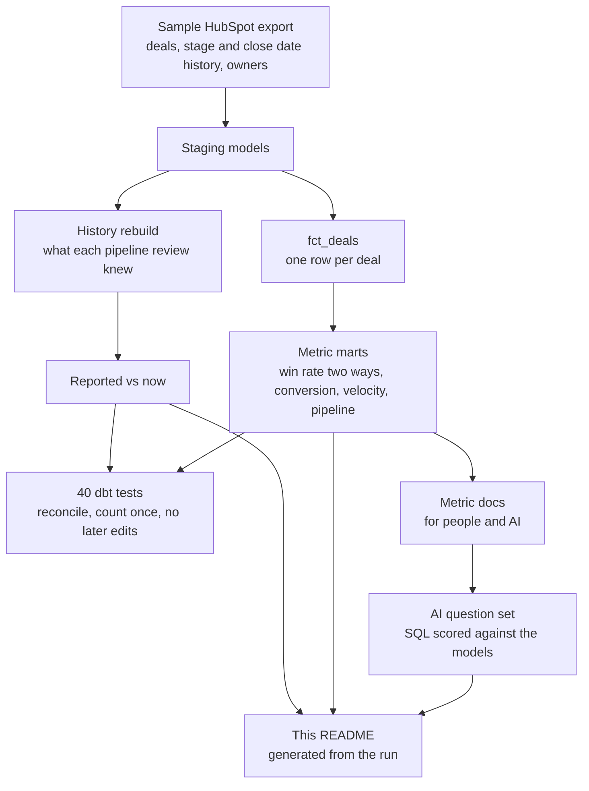
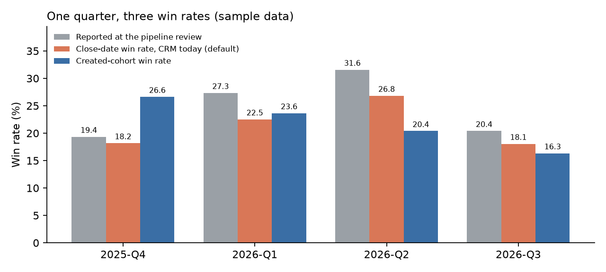

# Kit's pipeline numbers, for people and for AI

**What this is:** a dbt project that turns a HubSpot-style deal export into the sales metrics a pipeline
review runs on (win rate, stage conversion, deal velocity, open pipeline), rebuilds what each quarter's
review actually knew from the CRM's property history, and tests whether an AI can answer routine sales
questions from the metric docs alone. It is a small version of what Kit's Senior Analytics Engineer
posting asks for, built on **sample data in HubSpot's deal shape** (900 synthetic deals; no Kit data).

## Architecture



## What I found

**1. The number we reported is not the number the CRM shows now.** 2026-Q2's win rate was **31.6%**
at the pipeline review a week after the quarter. The CRM says **26.8%** today, 4.8 points lower: 20 of
164 closed deals moved after the review (losses logged late, close dates backdated). In every one
of the 4 complete quarters the reported rate was higher, by 1.2 points to 4.8 points.
*So:* report from property history as of the review date, and show "changed since reported" next to it.

**2. One quarter has two honest win rates.** 2026-Q2 is **26.8%** by close date and **20.4%** by the
quarter deals were created, 6.4 points apart. Both are right; they answer different questions.
*So:* close date is the default ("how did the quarter go"); cohort is labelled as deal quality, never
mixed in the same chart without saying which is which.

**3. An AI answered from the docs alone, and its one miss was silent.**

| Question set | One-line docs (v1) | Rewritten docs (v2) |
|---|---|---|
| 10 routine questions (one mart answers each) | 10/10 | not needed |
| 10 questions no single mart answers | 9/10 | 10/10 |

The v1 miss: "how many deals are in Contract sent" filtered on the label instead of HubSpot's stage id
and returned **0** instead of **13**, with no error. The v2 docs name the grain, which
date counts, ids versus labels, and how to add up rates. (One run per docs version with a fresh AI each
time: an example of the failure, not a benchmark.)
*So:* name a mart after each routine question, and keep a question set like this as a test that runs
whenever a definition changes.



## What I would do in my first month at Kit

1. Map HubSpot deals, pipelines and stages, companies, contacts and owners into the dbt models, and list the gaps.
2. Rebuild last quarter's reported win rate from property history and measure the gap on real data.
3. Write down the competing win rate definitions with RevOps, pick a default, and document the outcome.
4. Turn the questions Sales and RevOps actually ask into an AI question set that runs as a test.

*Assumptions:* the data is synthetic, in HubSpot's default deal and pipeline shape; the "pipeline review"
is 7 days after quarter end; 49 of 900 sample deals were pushed back a stage at least once.

---

## How to run it

```bash
pip install dbt-duckdb matplotlib
python generate/make_sample_crm.py      # sample HubSpot-shaped export into seeds/
dbt build --profiles-dir .              # seeds, models and 40 tests on DuckDB
python eval/score.py eval/answers_hard_v2.json hard
python readout/build_readout.py --check # this page matches the data
```

The SQL avoids DuckDB-only syntax (`macros/portable.sql` switches the two functions that differ) so the
models run on Redshift.

## What is in the repo

| Path | What |
|---|---|
| `generate/` | The sample HubSpot export: deals, stage and close date history, owners, stages |
| `models/` | Staging, the history rebuild of what each review knew, `fct_deals`, one mart per metric |
| `tests/` | Rates are shares, won amount reconciles to the cent, each deal counted once, reviews never see later edits |
| `docs/metrics.md` | The v2 definitions, written for people and AI tools |
| `eval/` | The questions, the AI's SQL for each docs version, and the scorer |
| `readout/` | This page's generator and chart |
